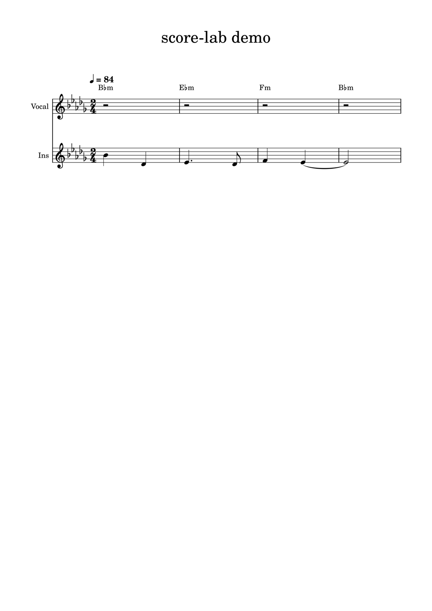

# score-lab

مساحة صغيرة للتعلّم والفضول حول **السكور**: كيف يُكتب، كيف يُقرأ، وكيف ينتقل من
نص ABC إلى ورقة مطبوعة في MuseScore.

*Score notation sandbox — ABC → MusicXML → MuseScore, plus a primer on reading a
score. Unrelated to any production project; this is for learning.*



> المشروع الأم: [akbargherbal/arabmaqamrock](https://github.com/akbargherbal/arabmaqamrock).
> هذا المستودع **منفصل تمامًا** ولا يشارك أي كود أو بيانات معه؛ أُخذ منه فقط
> ملف `abc_tools.py` المنسوخ (MIT) ليفهم لهجة ABC المستخدمة هناك.

---

## شنو موجود هنا

| المسار | شنو |
|---|---|
| `docs/abc-primer-ar.md` | **ابدأ من هنا**: شنو السكور، شنو ABC، جدول الرموز والمدد، وكيف تقرأ ملفًا سطرًا بسطر |
| `docs/musescore-on-wsl.md` | تثبيت MuseScore على WSL بلا أي بناء، التشغيل الرسومي والـheadless، وربط MCP |
| `docs/synchronized-viewer.md` | العارض المتزامن: التسجيل الأصلي + البارات والكوردات والأقسام والنوتات وصفحة السكور في وقت واحد |
| `tools/abc_to_musicxml.py` | تحويل سكور ABC (لهجة arabmaqamrock) إلى MusicXML 4.0 الذي يفتحه MuseScore |
| `tools/musescore` | مُشغّل الواجهة الرسومية (WSLg) |
| `tools/mscore-cli` | تحويل/تصدير بلا نافذة: pdf, png, mp3, flac, mid, mscz |
| `tools/take_shot.sh` | تصوير نافذة WSLg (MuseScore) من جهة ويندوز — `--list`, `--wait`, `--client`، للتحقق البصري |
| `tools/score_viewer.py` | عارض متزامن: التسجيل الأصلي + الموجة + البارات + الكوردات + الأقسام + النوتات + صفحة السكور على خط زمني واحد |
| `tools/view_run.py` | يبني العارض لكل تراكات تشغيلية + فهرس `index.html`، مع جلب الصوت من `gs://` |
| `tools/vendor/` | نسخة مثبّتة من parser `abc_tools.py` (MIT) ليكون المستودع مكتفيًا بذاته |
| `examples/demo.abc` | ٤ بارات: كوردات + لحن + ربط (tie) عبر خط البار |
| `tests/` | ١١ اختبار على المحوّل (بدون شبكة، بدون MuseScore) |

## البدء السريع

```bash
# 1) MuseScore (AppImage، بلا بناء — التفاصيل في docs/musescore-on-wsl.md)
mkdir -p ~/Applications
curl -fL -o ~/Applications/MuseScore-Studio-4.7.7.AppImage \
  https://github.com/musescore/MuseScore/releases/download/v4.7.7/MuseScore-Studio-4.7.7.261109195-x86_64.AppImage
chmod +x ~/Applications/MuseScore-Studio-4.7.7.AppImage

# 2) ABC -> MusicXML، ثم ورقة PDF
python3 tools/abc_to_musicxml.py examples/demo.abc \
    --out /tmp/demo.musicxml --render pdf
```

بعدها `/tmp/demo.pdf` جاهز، أو افتح الموسيقى تفاعليًا:

```bash
tools/musescore /tmp/demo.musicxml
```

## المحوّل `abc_to_musicxml.py`

- جزء MusicXML واحد لكل صوت ABC (`Vocal`, `Ins`)
- الكوردات في سطور مزدوجة تصير `<harmony>` على ستاف Vocal
- إعادة بناء دقيقة: تقسيم النوتات على خطوط البارات مع `tie`، ملء الفراغات
  سكتات، بارات فاضية سكتة كاملة، تغييرات المقام والوزن، والسرعة
- `divisions=8` لأن لهجة ABC كلها مضاعفات `1/32` — بلا أي تقريب
- `verify()` يقرأ المخرَج مرة ثانية ويقارن مجموع المدد مع المصدر، ويرفض أي فقد
  صامت

```bash
python3 tools/abc_to_musicxml.py score.abc --out score.musicxml \
    --title "اسم القطعة" --render pdf --render png --render mid
```

`MUSESCORE` متغيّر بيئة يحدد الملف التنفيذي، وافتراضيًا يستخدم `mscore-cli`
أو `musescore` من الـ`PATH`.

## الاختبارات

```bash
python3 -m pytest tests -q      # أو: python3 -m unittest discover tests
```

## حدود

- هذا المستودع **ليس** جزءًا من أي pipeline إنتاجي، ولا يُستورد من المشروع الأم.
- اللهجة المدعومة هي لهجة `arabmaqamrock` الصارمة: صوتان، `L:1/32`، بلا أقواس
  نوتات، بلا بارات تكرار.
- MuseScore لا يفتح ABC أبدًا — لذلك وُجد هذا المحوّل.

## الترخيص

MIT — انظر `LICENSE`. أما `tools/vendor/abc_tools.py` فمن YuE2 (MIT،
انظر `tools/vendor/LICENSE`).
